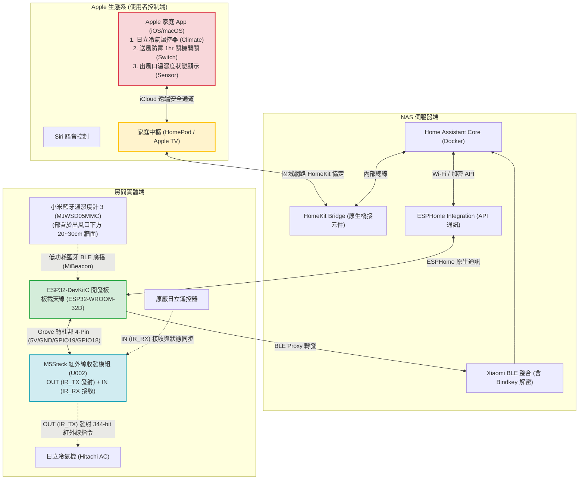
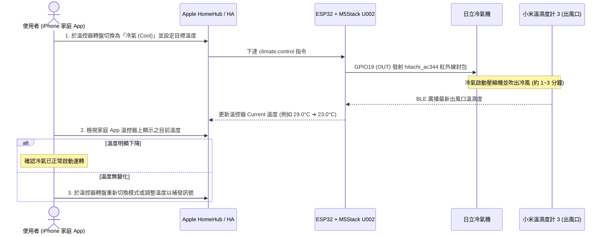

# 外出冷氣控制系統 (AC Remote Controller) — 系統設計規格書 (System Specification)

本規格書定義外出冷氣控制系統之硬體架構、腳位接線定義、ESPHome 紅外線收發與藍牙網關韌體配置、Home Assistant 伺服器端整合、Apple HomeKit 橋接介面以及遠端操作溫度確認流程。

---

## 1. 系統架構圖 (System Architecture Diagram)



---

## 2. 硬體清單與接線規格 (Hardware & Wiring Specification)

### 2.1 實體設備清單 (BOM)
1. **核心控制器**：`ESP32-DevKitC` 開發板 — 板載天線 (`ESP32-WROOM-32D`)
   * 供電輸入：5V Micro-USB / Type-C（連接 5V USB 電源供應器）。
   * 腳位特性：支援 5V (`5V` / `VIN` 腳位) 輸出供電，GPIO 邏輯電平為 3.3V。
2. **紅外線收發器**：`M5Stack 紅外線收發模組 (U002 / IR Unit)`
   * 內建 940nm 紅外線發射 LED（含電晶體放大驅動電路）與 38kHz 解調紅外線接收器。
   * 介面規格：`HY2.0-4P (Grove)` 四芯接口。
3. **溫濕度感測器**：`小米藍牙溫濕度計 3 (MJWSD05MMC)`
   * 供電：CR2450 鈕扣電池。
   * 部署位置：冷氣出風口下方約 20~30 公分牆面。
4. **連接線材**：`Grove (HY2.0-4P) 轉 4Pin 2.54mm 杜邦母頭線`（1 條）。

### 2.2 腳位連接定義 (Pinout Mapping)
使用 **Grove 轉 4Pin 杜邦母頭線** 連接 `M5Stack U002` 與 `ESP32-DevKitC`：

| M5Stack U002 (外殼標示) | 線材顏色參考 | ESP32-DevKitC 對應腳位 | 功能說明 |
| :--- | :--- | :--- | :--- |
| **`GND`** | 黑色 (Black) | **`GND`** | 系統共地線 |
| **`5V`** | 紅色 (Red) | **`5V` (或 `VIN`)** | 5V 電源供應（供電予 U002 內部發射放大驅動電路與接收器） |
| **`OUT` (`IR_TX` / 發射)** | 白色 (White) | **`GPIO 19`** | 紅外線發射訊號 (`IR OUT` / 主控 Output) |
| **`IN` (`IR_RX` / 接收)** | 黃色 (Yellow) | **`GPIO 18`** | 紅外線接收訊號 (`IR IN` / 主控 Input，用於擷取與解析遙控器訊號） |

```text
       +-----------------------------------------------+
       |        ESP32-DevKitC (ESP32-WROOM-32D)        |
       |                                               |
       |   5V (VIN)     GND       GPIO19      GPIO18   |
       +------|----------|----------|-----------|------+
              |          |          |           |
              | 紅(Red)  | 黑(Blk)  | 白(Wht)   | 黃(Yel)
              | 5V       | GND      | OUT(TX)   | IN(RX)
       +------|----------|----------|-----------|------+
       |     5V         GND      OUT(IR_TX)  IN(IR_RX) |
       |          M5Stack IR Unit (U002)               |
       +-----------------------------------------------+
```

---

## 3. 韌體規格書 (ESPHome Firmware Specification)

經實機紅外線訊號擷取與協定解碼驗證，日立冷氣遙控器採用 **`hitachi_ac344`**（43 Bytes / 344-bit 狀態型紅外線協定）。系統韌體定義以下兩個核心控制元件與藍牙網關功能：

1. **空調溫控器實體 (`climate.hitachi_ac344`)**
   * 顯示名稱：`日立冷氣 (Hitachi AC)`。
   * 支援功能：溫度設定（`16°C ~ 30°C`）、運轉模式切換（`Off` / `Cool` / `Heat` / `Auto` / `Dry` / `Fan Only`）與風速控制。
   * 環境溫濕度回饋：透過 `homeassistant` 感測器平台同步**小米藍牙溫濕度計 3** 之即時溫濕度數據，作為溫控器之當前環境溫度（`Current`）顯示依據。
2. **送風防霉定時關機開關 (`switch.template` + `script`)**
   * 顯示名稱：`送風防霉 1hr 關機 (Fan 1h)`。
   * 運作邏輯：開啟開關時，立即發射「送風模式 (`FAN_ONLY`) + 低風速 (`LOW`)」紅外線指令以吹乾冷氣內部冷凝水，並啟動 ESP32 內部 60 分鐘倒數計時器（`script.fan_1hr_timer`）。計時結束後，自動發射 `OFF` 關機指令、將預設風速重置為 `AUTO`，並將開關狀態歸位為關閉。若中途手動關閉此開關，則立即中止倒數計時。

### 3.1 ESPHome YAML 設定檔規格 (`firmware/ac-remote-controller.yaml`)
```yaml
esphome:
  name: ac-remote-controller
  friendly_name: AC Remote Controller

esp32:
  board: esp32dev
  framework:
    type: esp-idf

# 藍牙網關功能 (BLE Proxy)，接收小米藍牙溫濕度計 3 廣播訊號
esp32_ble_tracker:
  scan_parameters:
    interval: 320ms
    window: 300ms
    active: true

bluetooth_proxy:
  active: true

wifi:
  ssid: !secret wifi_ssid
  password: !secret wifi_password
  ap:
    ssid: "AC-Controller-Fallback-AP"

captive_portal:

api:
  encryption:
    key: !secret api_encryption_key

ota:
  - platform: esphome

logger:
  level: INFO

# M5Stack U002 紅外線接收器 (GPIO18, Active-Low)
remote_receiver:
  id: ir_rx
  pin:
    number: GPIO18
    inverted: true
    mode:
      input: true
      pullup: true
  dump:
    - raw
  idle: 25ms
  rmt_symbols: 256
  filter_symbols: 100
  receive_symbols: 1024

# M5Stack U002 紅外線發射器 (GPIO19)
remote_transmitter:
  pin: GPIO19
  carrier_duty_percent: 50%
  non_blocking: true
  rmt_symbols: 256

# 由 Home Assistant 同步小米藍牙溫濕度計 3 即時數據
sensor:
  - platform: homeassistant
    id: ac_outlet_temp
    entity_id: sensor.ke_ting_temperature_humidity_sensor_84d3_temperature
    internal: true

  - platform: homeassistant
    id: ac_outlet_humidity
    entity_id: sensor.ke_ting_temperature_humidity_sensor_84d3_humidity
    internal: true

# 日立冷氣 344-bit (HITACHI_AC344) 溫控實體 (Climate)
climate:
  - platform: hitachi_ac344
    id: hitachi_ac
    name: "日立冷氣 (Hitachi AC)"
    receiver_id: ir_rx
    sensor: ac_outlet_temp
    humidity_sensor: ac_outlet_humidity
    supports_cool: true
    supports_heat: true

# 1 小時送風防霉倒數計時腳本
script:
  - id: fan_1hr_timer
    mode: restart
    then:
      - logger.log: "Starting 60-minute Fan-Only mildew-proof countdown..."
      - delay: 60min
      - logger.log: "60-minute countdown finished! Turning off Hitachi AC..."
      - climate.control:
          id: hitachi_ac
          mode: "OFF"
          fan_mode: "AUTO"
      - switch.turn_off: btn_fan_1hr

# 送風防霉 1 小時自動關機控制開關 (Switch)
switch:
  - platform: template
    name: "送風防霉 1hr 關機 (Fan 1h)"
    id: btn_fan_1hr
    icon: "mdi:fan-clock"
    optimistic: true
    turn_on_action:
      - logger.log: "Switching Hitachi AC to FAN_ONLY mode for 1 hour..."
      - climate.control:
          id: hitachi_ac
          mode: "FAN_ONLY"
          fan_mode: "LOW"
      - script.execute: fan_1hr_timer
    turn_off_action:
      - logger.log: "Stopping 1-hour Fan-Only timer."
      - script.stop: fan_1hr_timer
```

---

## 4. 伺服器端與前端規格書 (Home Assistant & Apple HomeKit Specification)

### 4.1 小米藍牙溫濕度計 3 (`MJWSD05MMC`) 接入流程
由於小米藍牙溫濕度計 3 原廠廣播採用 MiBeacon 加密，接入步驟如下：
1. 將溫濕度計 3 加入手機「米家 App」並綁定小米帳號。
2. 使用開源工具 **`Xiaomi Cloud Token Extractor`** 登入同一小米帳號，提取該設備之 **`Bindkey` (32 位元十六進位藍牙加密金鑰)**。
3. 當 ESP32 啟用 `bluetooth_proxy` 後，Home Assistant 將自動探索該感測器；於 HA 的 **`Xiaomi BLE`** 整合輸入上述 `Bindkey`，即建立以下實體：
   * `sensor.ke_ting_temperature_humidity_sensor_84d3_temperature` (溫度)
   * `sensor.ke_ting_temperature_humidity_sensor_84d3_humidity` (濕度)
   * `sensor.ke_ting_temperature_humidity_sensor_84d3_battery` (電池電量)

### 4.2 Apple HomeKit 橋接配置 (`HomeKit Bridge`)
* **HA 橋接元件**：`HomeKit Bridge`。
* **暴露至 Apple 家庭之實體**：
  1. `climate.ac_remote_controller_ri_li_leng_qi_hitachi_ac` ➔ **「日立冷氣 (Hitachi AC)」**（溫控器轉盤，整合即時溫度顯示、模式與風速設定）
  2. `switch.ac_remote_controller_song_feng_fang_mei_1hr_guan_ji_fan_1h` ➔ **「送風防霉 1hr 關機 (Fan 1h)」**（送風防霉定時關機開關）
  3. `sensor.ke_ting_temperature_humidity_sensor_84d3_temperature` / `_humidity` ➔ **「溫度 / 濕度感測器」**（顯示於房間狀態列與溫控器面板）

---

## 5. 操作與狀態確認流程 (Operation & Verification Flow)

由於傳統冷氣紅外線遙控為單向發射（冷氣機身有接收時的「嗶」聲提示，但不會向控制器回傳數位封包），遠端操作時可透過溫控器面板整合之「出風口即時溫度」確認冷氣運轉狀態：



---

## 6. 測試與驗證計畫 (Testing & Verification Plan)

| 測試編號 | 測試項目 | 驗證標準 | 測試方法 |
| :--- | :--- | :--- | :--- |
| **TC-01** | 原廠遙控器紅外線接收與解碼 (`IR_RX`) | ESPHome Log 能正確接收並解析原廠遙控器之 344-bit 封包 | 將日立遙控器對準 M5Stack U002 按下開關機與調溫，確認 Log 輸出對應之 `hitachi_ac344` 狀態。 |
| **TC-02** | 溫控器紅外線發射測試 (`IR_TX`) | 於 Apple 家庭操作溫控轉盤時，冷氣發出「嗶」聲並切換對應溫度與模式 | 於 Apple 家庭切換冷氣/暖氣/調溫，確認冷氣機正常響應。 |
| **TC-03** | 送風防霉 1hr 自動關機測試 | 開啟「送風防霉 1hr 關機」後冷氣切換為送風，60 分鐘後自動發射關機指令 | 點擊該開關確認切換為送風，並驗證計時結束後冷氣自動關機且開關狀態歸位。 |
| **TC-04** | 小米溫濕度計 3 藍牙網關與溫控器連動 | 溫濕度數據穩定更新至 HA，並正確顯示於 Apple 家庭冷氣轉盤之 `Current` 欄位 | 觀察 Apple 家庭溫控器面板之當前溫度是否與小米溫濕度計 3 螢幕數值一致。 |
| **TC-05** | 多手機家庭共享與遠端 5G 操作驗證 | 家庭成員之 iPhone 皆可同步顯示配件，且於外部行動網路下可正常操作並觀察降溫 | 將配件移入「客廳」確認家人手機同步出現，並使用行動網路測試遠端控制。 |
